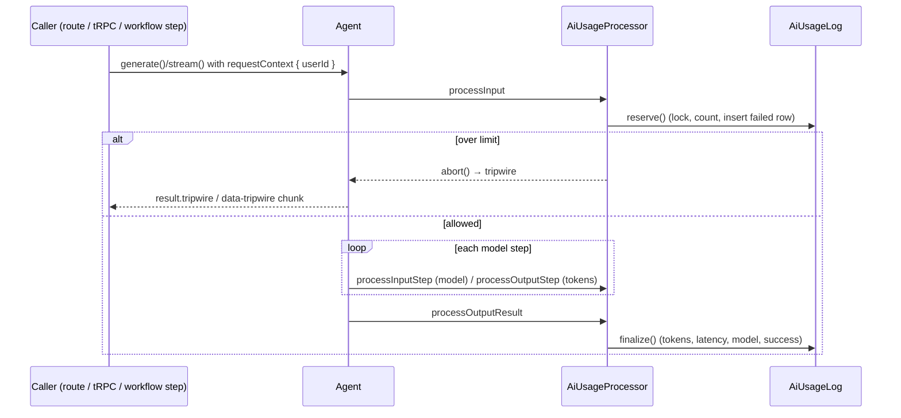

# AI Layer (Mastra) Setup

How the Mastra AI layer is wired up, how a call is traced, logged and rate-limited, and how to add new agents safely.

| PR / commit    | Ticket      | What it added                                                                                     |
| -------------- | ----------- | ------------------------------------------------------------------------------------------------- |
| #14            | S1-05       | Mastra instance, starter weather agent/tool/workflow, memory, dev chat endpoint and page          |
| #28            | S1-11 (#20) | Tracing, structured logging, content redaction, `AiUsageLog` table, per-user rate limiting, evals |
| `S1-12` branch | S1-12 (#27) | Moved rate limiting and usage logging into a Mastra processor so every agent call is covered      |

## Table of Contents

- [Layout](#layout)
- [The Mastra Instance](#the-mastra-instance)
- [Agents, Tools and Workflows](#agents-tools-and-workflows)
- [Insight Reports](#insight-reports)
- [Dev Chat Demo](#dev-chat-demo)
- [Observability](#observability)
- [Usage Logging and Rate Limiting](#usage-logging-and-rate-limiting)
- [Evals](#evals)
- [Environment Variables](#environment-variables)
- [Adding a New Agent](#adding-a-new-agent)
- [Known Limitations](#known-limitations)

## Layout

```text
src/mastra/
├── index.ts                  # Mastra instance: registers agents, workflows, scorers, storage, observability
├── observability.ts          # Pino logger, tracing config, ContentRedactionProcessor
├── agents/weather-agent.ts   # Starter agent (model, memory, tools, usage processor)
├── tools/weather-tool.ts     # Starter tool (Open-Meteo)
├── workflows/weather-workflow.ts
├── scorers/index.ts          # Answer relevancy + toxicity scorers (LLM judge)
├── evals/weather-agent.eval.ts
└── guardrails/
    ├── AiUsageService.ts     # DB-backed rate limit + usage rows (reserve / finalize)
    ├── AiUsageProcessor.ts   # Mastra processor that calls the service on every agent call
    ├── requestContext.ts     # USER_ID_KEY + createUserRequestContext()
    └── chatStream.ts         # peekRateLimit(): turns a rate-limit tripwire into an HTTP 429

app/api/dev/chat/route.ts     # Dev-only chat endpoint (POST: stream, GET: history)
app/dev/chat/page.tsx         # Dev-only chat UI (useChat + AI Elements)
```

> Rule (from `AGENTS.md`): load the `mastra` skill before any Mastra work, and check the docs bundled in `node_modules/@mastra/*/dist/docs/` instead of relying on memory. The Mastra API changes often.

## The Mastra Instance

`src/mastra/index.ts` exports a single `mastra` instance. **Every agent, tool, workflow and scorer must be registered here.**

- **Storage:** a `MastraCompositeStore` with two parts:
  - **Default (memory, threads, workflow state):** `LibSQLStore`. It uses Turso when `TURSO_DATABASE_URL` is set and a local `mastra.db` file otherwise.
  - **Observability domain (traces, metrics, scores):** a local DuckDB store (`mastra.duckdb`).
  - Both local files are git-ignored.
- **Logger and observability:** both come from `observability.ts` (see [Observability](#observability)).
- **Next.js:** the Mastra server packages are listed in `serverExternalPackages` in `next.config.ts`, so Next doesn't try to bundle them.

Use the `npm run dev` / `npm run build` scripts rather than calling `mastra dev` / `mastra build` directly. Mastra Studio runs at `http://localhost:4111` for inspecting agents, workflows and traces.

## Agents, Tools and Workflows

These are starter examples from #14, and they serve as the reference pattern.

- **`weather-agent`** (`openai/gpt-5-mini`):
  - Uses `weatherTool`.
  - Has `Memory` (threads stored in LibSQL).
  - Lists `aiUsageProcessor` in both `inputProcessors` and `outputProcessors`. Every agent must do this (see [Usage Logging and Rate Limiting](#usage-logging-and-rate-limiting)).
- **`weatherTool`:** geocodes a city and fetches current conditions from Open-Meteo.
- **`weather-workflow`:** runs two steps.
  1. `fetch-weather` fetches the forecast.
  2. `plan-activities` streams activity suggestions from `weatherAgent`. It passes the workflow's `requestContext` into `agent.stream()`, because Mastra doesn't pass it on automatically. If the agent call is blocked (a tripwire), the step throws so the workflow fails visibly.

## Insight Reports

`insightsAgent` turns analyzed journal-entry summaries and themes into a stored report of recurring themes, gentle growth suggestions, and an optional trend caption. It is registered in `src/mastra/index.ts` and has `aiUsageProcessor` in both processor arrays.

- `InsightReportService` reads only live, user-owned entries that already have `EntryAnalysis` data. It uses UTC calendar days: the current 30-day period and the immediately preceding 30-day period.
- Reports require at least five analyzed entries in the current period. The model receives summaries and themes, never raw journal bodies, and must cite the supplied entry IDs for every theme and suggestion. Invalid or foreign entry IDs are discarded before persistence.
- `INSIGHT_REPORT_MAX_SOURCE_ENTRIES` limits model context (default `50`, never less than five). When the period has more entries, the service selects the most recent entries and keeps them in oldest-to-newest order; stored `entryCount` and valid source references describe that selected input. Previous-period theme counts remain aggregated across the whole previous period.
- `INSIGHT_REPORT_GENERATION_TIMEOUT_MS` limits the model run (default `10` minutes). It is clamped to at least one minute below the 15-minute `InsightReportLease`; source loading also consumes that same deadline, so the service does not start a model call after the safety margin. Mastra aborts timed-out runs and forwards cancellation to the provider, but no application timeout can guarantee that a provider has not already incurred partial billing after accepting a request.
- `InsightReportLease` plus a PostgreSQL advisory transaction lock limits each user to one active generation. A successful report starts a 24-hour refresh cooldown.
- `v1.insights.report` returns only the authenticated user's latest valid report. `v1.insights.refresh` runs `insightsWorkflow` with the session-derived request context.
- There is no scheduled refresh yet. A weekly external scheduler needs a deployment/auth decision before it is added; reports are refreshed from the signed-in UI for now.

## Dev Chat Demo

This is a dev-only demo of the full stack, from browser to agent to stream. Both `/dev/*` pages and `/api/dev/*` routes return **404 in production builds**.

- **`app/dev/chat/page.tsx`:** a chat UI built on AI SDK `useChat` and shadcn-based AI Elements components.
- **`POST /api/dev/chat`:**
  1. Requires a better-auth session and returns 401 without one.
  2. Forwards only what the client sends: `messages`, `trigger` and `resumeData`. Execution options stay server-controlled.
  3. Calls `handleChatStream` (`@mastra/ai-sdk`, AI SDK v7) with:
     - `requestContext: createUserRequestContext(userId)`;
     - `abortSignal: req.signal`, so a disconnect stops generation;
     - one memory thread per user (`dev-chat-<userId>`).
  4. Runs `peekRateLimit()` on the stream and returns **429** if the call was rejected for being over the limit.
- **`GET /api/dev/chat`:** returns the user's thread history, converted to AI SDK UI messages.

## Observability

All of this lives in `src/mastra/observability.ts` (#28).

- **Logger:** a structured `PinoLogger`, with the level set by `LOG_LEVEL` (default `info`). It is shared by the Mastra instance and the guardrails. Never use `console.log`, which CI rejects.
- **Tracing:** every agent and workflow call is traced. Traces include the agent name, model, latency, token counts and the **user ID**.
  - The user ID comes from `requestContextKeys: [USER_ID_KEY]`, which copies `userId` from the RequestContext onto each trace.
- **Exporters:**
  - `MastraStorageExporter` writes to the DuckDB observability store, which Studio reads.
  - `MastraPlatformExporter` sends to the Mastra Platform, and only does so when `MASTRA_PLATFORM_ACCESS_TOKEN` is set.
- **Redaction:** spans pass through two span output processors before export.
  - `SensitiveDataFilter` masks passwords, tokens and keys.
  - `ContentRedactionProcessor` strips span input/output (prompts, completions, tool args and results) and the `prompt` and `instructions` attributes, **unless `AI_LOG_CONTENT=true`**. Model, usage, timing and metadata are kept.

## Usage Logging and Rate Limiting

### The `AiUsageLog` table (#28)

The table is defined in `prisma/schema.prisma` and created by migration `20261101064054_add_ai_usage_log`. It has one row per agent call.

| Field                                      | Notes                                                                                         |
| ------------------------------------------ | --------------------------------------------------------------------------------------------- |
| `id`                                       | uuid PK                                                                                       |
| `userId`                                   | Nullable. `null` means a system call (no signed-in user). FK to `User`, set to null on delete |
| `agent`, `model`                           | Agent ID and `provider/modelId` actually used                                                 |
| `inputTokens`, `outputTokens`, `latencyMs` | Call totals                                                                                   |
| `success`                                  | `false` on error, abort, or a call that never finished                                        |
| `createdAt`                                | Indexed with `userId` for the rate-limit window query                                         |

### `AiUsageService` (#28, `null` user support added in S1-12)

- **`reserve({ userId, agent, model })`:** runs **before the model is called**, in one transaction.
  1. Takes a per-user Postgres advisory lock (`pg_advisory_xact_lock(hashtext(userId))`) so concurrent requests can't all pass the count.
  2. Counts the user's rows in the rolling window. If the count is at the limit or above, it throws `TRPCError('TOO_MANY_REQUESTS')`.
  3. Otherwise it inserts the row as a **failed call with 0 tokens** and returns its ID. Calls still in progress therefore count toward the limit, and a call that never finishes stays recorded as failed.

  When `userId` is `null` (system calls), it skips the lock and the count and just inserts the row.

- **`finalize(id, outcome)`:** fills in the row with tokens, latency, model and success. **It never throws**, because a logging failure must not fail the AI call; errors are logged instead.
- **Config:** read on every call from `AI_RATE_LIMIT_WINDOW_SECONDS` (default 3600) and `AI_RATE_LIMIT_MAX_CALLS` (default 50).

The limit lives in the DB on purpose: an in-memory counter would reset on every serverless cold start. The trade-off is that the window is counted per call, not per token.

### `AiUsageProcessor`: enforcement at the Mastra layer (S1-12)

In #28, enforcement only happened when a caller spread `guardAgentCall()` into its call options. A route, tRPC procedure or workflow step that called an agent directly skipped both the limit and the log row. S1-12 replaced that helper with a **Mastra processor attached to the agent itself**, so it runs however the agent is called.

One `aiUsageProcessor` instance is listed in both `inputProcessors` and `outputProcessors`. Mastra gives each processor a per-request `state` object that is shared across both phases, so the singleton is safe to share.

| Hook                                               | What it does                                                                                                                                                                                                                                                                                       |
| -------------------------------------------------- | -------------------------------------------------------------------------------------------------------------------------------------------------------------------------------------------------------------------------------------------------------------------------------------------------- |
| `processInput` (once, before the first model call) | Reads `userId` from the RequestContext (`null` if missing). Resolves the agent's configured model and calls `reserve()`. On `TOO_MANY_REQUESTS` it calls `abort()` with metadata `{ code: 'TOO_MANY_REQUESTS' }`, which raises a **tripwire**. Other errors are rethrown, so the call fails closed |
| `processInputStep` (each step)                     | Records the model actually used, including any switch made by another processor                                                                                                                                                                                                                    |
| `processOutputStep` (each step)                    | Adds the step's tokens to a running total, so failed or aborted calls still report what they spent                                                                                                                                                                                                 |
| `processOutputResult` (once, at the end)           | Calls `finalize()` once. `success` is false when `finishReason` is `error` or `aborted`                                                                                                                                                                                                            |

The call flow:



### Handling an over-limit call (the tripwire)

An over-limit call doesn't throw. Mastra reports it as a **tripwire**, and each kind of caller turns it into an error differently:

| Caller                                     | What it gets                                                                 | What to do                                                                                               |
| ------------------------------------------ | ---------------------------------------------------------------------------- | -------------------------------------------------------------------------------------------------------- |
| `agent.generate()` (e.g. a tRPC procedure) | `result.tripwire`                                                            | Call `assertNotRateLimited(result)` right after `generate()`. It throws `TRPCError('TOO_MANY_REQUESTS')` |
| `agent.stream()`                           | A `tripwire` chunk; `response.tripwire` is set once the stream has been read | Check `response.tripwire` after reading the stream (see `plan-activities`)                               |
| `handleChatStream`                         | A `data-tripwire` chunk inside a 200 stream                                  | Wrap the stream with `peekRateLimit(stream)` and return 429 when `limited`                               |

`isAiRateLimited(tripwire)` is true only for tripwires from this processor (`processorId === 'ai-usage'`) whose metadata code is `TOO_MANY_REQUESTS`. Tripwires from other processors pass through.

### Passing the user ID

- **User-triggered calls:** pass `requestContext: createUserRequestContext(userId)`, where `userId` comes from the better-auth session.
- **Workflows:** pass the same context to `run.start(...)`. Steps must forward their `requestContext` into any `agent.generate()` / `agent.stream()` they call; it isn't propagated automatically.
- **No context:** the call is logged as a system call (`userId: null`) and isn't rate-limited.

## Evals

Agent evaluations use `runEvals()` with `vitest.eval.config.mts`. They are separate from unit tests because they call `openai/gpt-5-mini`.

- **Jaden suite:** `src/mastra/evals/journal-companion-agent.eval.ts` uses two synthetic users and fixture-backed entries. It hard-gates grounded facts, exact entry citations, uncertainty for unsupported questions, prompt-injection resistance, full-entry retrieval, and user isolation. Tone must score at least `0.8`; toxicity must score no more than `0.1`.
- **Entry Title suite:** `src/mastra/evals/entry-title-agent.eval.ts` hard-gates the title contract (3–8 words, no quotes/trailing period/emojis/hashtags, and application length limit) and prompt-injection resistance. Its relevance, language, and tone judge must score at least `0.8`.
- **Fixtures:** `src/mastra/evals/fixtures/` contains only fictional users and entries. Eval files replace Prisma with an in-memory fixture client, so the suites never read production journal data or write production `AiUsageLog` rows.
- **Run both suites:** `npm run eval`
- **Run Jaden only:** `npm run eval:jaden`
- **Run Entry Title only:** `npm run eval:titles`

Each command needs `OPENAI_API_KEY`. Do not run these commands from CI or during normal unit tests without intentionally approving model usage and cost.

By default, evals force `AI_LOG_CONTENT=false`, even when a local `.env` sets it. To retain synthetic response text and judge rationale while diagnosing a live eval, run only from an isolated temporary harness with both `EVAL_ISOLATED_HARNESS=true` and `EVAL_LOG_SYNTHETIC_CONTENT=true`. Never enable content logging in the repository's normal environment.

## Environment Variables

| Variable                                 | Default           | Purpose                                            |
| ---------------------------------------- | ----------------- | -------------------------------------------------- |
| `OPENAI_API_KEY`                         | —                 | Model provider key (agent and eval judge)          |
| `TURSO_DATABASE_URL`, `TURSO_AUTH_TOKEN` | local `mastra.db` | Hosted LibSQL for Mastra memory and workflow state |
| `MASTRA_PLATFORM_ACCESS_TOKEN`           | unset             | Turns on the Mastra Platform trace exporter        |
| `AI_LOG_CONTENT`                         | `false`           | `true` keeps prompts and completions in traces     |
| `AI_RATE_LIMIT_WINDOW_SECONDS`           | `3600`            | Rolling rate-limit window                          |
| `AI_RATE_LIMIT_MAX_CALLS`                | `50`              | Max calls per user per window                      |
| `LOG_LEVEL`                              | `info`            | Pino log level                                     |

## Adding a New Agent

1. Create it in `src/mastra/agents/` and register it in `src/mastra/index.ts`.
2. Add `inputProcessors: [aiUsageProcessor]` and `outputProcessors: [aiUsageProcessor]`. Mastra has no instance-wide way to attach processors, so each agent must list them.
   - If you pass processor arrays per call to `generate()`/`stream()`, they **replace** the agent's arrays. Include `aiUsageProcessor` there too.
3. Call it with `createUserRequestContext(userId)` for user-triggered calls.
4. Turn a tripwire into a 429 or `TRPCError` using the right helper from [Handling an over-limit call](#handling-an-over-limit-call-the-tripwire).

## Known Limitations

- **Concurrency slip:** the advisory lock serialises reservations per user, so concurrent requests can't race past the count. The window still counts calls, not tokens.
- **Process death:** if the server dies mid-call, the reserved row stays as a failed call with 0 tokens.
- **Sub-agents and `agent.network()`:** each agent that has the processor logs and counts its own call, so one delegation can use more than one call from the limit. The `structuredOutput` helper model (when a separate `model` is set) runs without processors, and its tokens aren't counted.
- **Model judges:** scorer and judge calls are not agents, so they don't write `AiUsageLog` rows. They do appear in traces.
